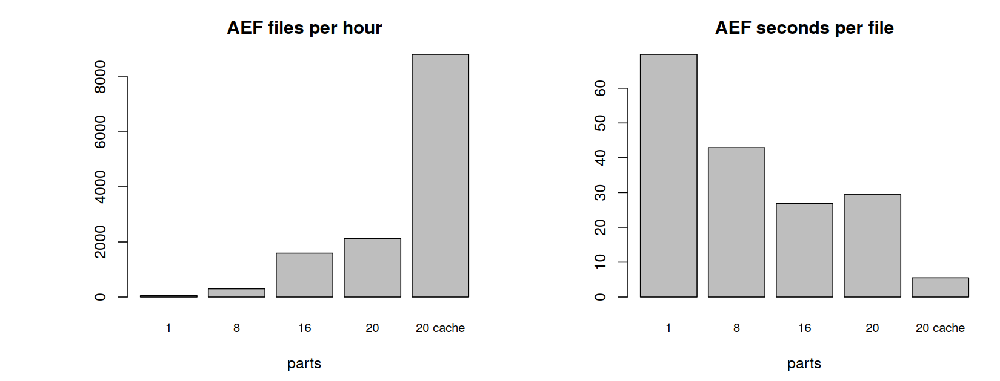

# Deep_embd_ben_NFI

R code to download AlphaEarth (AEF) and TESSERA embeddings for the BWI plots.
Part of the project "Deep Embeddings Benchmark for BWI Plot Imputation" with Thünen.

There are two run modes:

- `boxes`: one file per BWI cluster (a box around all rows of a cluster in the csv). This is what goes to Thünen.
- `tiles`: 10 x 10 km tiles over Germany + 100 km buffer, for our own maps.

Everything is in EPSG:25832 on the same 10 m grid, for 2021, 2022 and 2023.

## Folders

```
main.r              settings, runs everything
Scripts/
  setup.r           packages and GDAL settings
  areas.r           AOI, cluster boxes, overlapping boxes, tiles
  embeddings.r      reads AEF and TESSERA for one area
  download.r        download loop, file checks, readme for Thünen
notebooks/main.qmd  look at the data but run main.r first
data/               the csv from Thünen (not in git)
output/             made by main.r (not in git)
```

## Setup

R 4.4 or newer. The first time on a new computer, start R in the project folder and run:

```r
renv::restore()
```

zarr has to be 0.5.1 because geotessera does not work with zarr 1.0.0. renv takes care of that.

Put `bwi2022_cluster_buffer.csv` from Thünen into `data/`.

## Settings

All in section 1 of `main.r`. The ones I change most:

- `run_mode`: `"boxes"` or `"tiles"`
- `years` and `embeddings`
- `testing`: `TRUE` downloads only 10 boxes or 2 tiles
- `overlap_boxes`: `FALSE` leaves out the piles of overlapping boxes near Hachenburg, Kelheim and Eberswalde (112 boxes). Pairs of boxes are always kept.

## Output

- `output/grid/`: aoi, germany, cluster_boxes, dropped_boxes and tiles as gpkg, and plot_ids.csv
- `output/boxes/<year>/<embedding>/cluster_<7 digits>.tif`, or `output/tiles/...` for tiles
- `download_times_part_<n>.csv`: seconds for every download

AEF is saved as raw int8 (-128 = no data), the real value is `(v / 127.5)^2 * sign(v)`. TESSERA is float32.

## How to run

AEF is slow, about 40 s to 2 min per box and year, and most of that is waiting for the server.
So the full run is split into parts that run at the same time.

Run it from a terminal in the project folder (in RStudio use the Terminal tab, not the Console).

**1. Test run, alone**

Set `testing <- TRUE` in `main.r`, then:

```bash
cd path/to/Deep_embd_ben_NFI
Rscript main.r
```

This also saves the AEF file list in `data/cache/`, which all parts need. Do it once before starting parts on a new computer, or after deleting `data/cache/`.

**2. Full run in 8 parts**

Set `testing <- FALSE`, then:

```bash
mkdir -p output/logs
for i in 1 2 3 4 5 6 7 8; do nohup Rscript main.r $i 8 > output/logs/part_$i.txt 2>&1 & done
# for more parts, for e.g down is with 16
n=16; for i in $(seq 1 $n); do nohup Rscript main.r $i $n > output/logs/part_$i.txt 2>&1 & done
```

`Rscript main.r 3 8` means part 3 of 8. `nohup` keeps the parts running when the terminal is closed.

**While it runs**

```bash
tail -f output/logs/part_1.txt  # follow part 1, Ctrl+C only stops the watching
ls output/boxes/2021/alphaEarth | wc -l # boxes done for 2021
pkill -f "main.r"  # stop all parts
find output -name "*.part" -delete      # optional, removes the half files from the stop
```

To go on after a stop, run the same loop again. Files that already exist are skipped, so you can also change the number of parts.


---

## Time graph of download speed from testing



